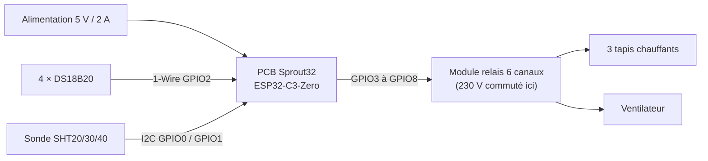

# Sprout32

Contrôleur de tente de semis basé sur un **ESP32-C3** : chauffage du substrat, ventilation, sondes de température et d'humidité, le tout commandé en local par **ESPHome** et intégrable à **Home Assistant**.

> **Statut : prototype.** Le PCB (v1.0) est dessiné mais n'a pas encore été fabriqué ni testé. Le firmware ESPHome sera publié après validation du matériel. Ce dépôt est partagé tel quel, sans garantie.

---

## ⚠️ Avertissement de sécurité (230 V)

Ce projet **commute du courant secteur (230 V)** par l'intermédiaire d'un module relais. Une erreur peut provoquer une électrocution, un court-circuit ou un incendie.

- Le PCB Sprout32 est **uniquement basse tension** (5 V / 3,3 V). Le 230 V ne passe **jamais** sur ce circuit imprimé : il est commuté sur le module relais, dans un boîtier fermé.
- Ce montage **n'est pas certifié** (pas de marquage CE, modules relais bon marché non homologués). Ne l'utilise que si tu sais travailler en sécurité sur du 230 V, ou fais-le réaliser par une personne compétente.
- Coupe toute alimentation avant de câbler ou de modifier quoi que ce soit.
- Protège le circuit en amont : **protection différentielle 30 mA**, fusible adapté (2 à 3 A pour les charges décrites ici), câbles de section suffisante, embouts de câble, serre-câbles.
- Place le module relais et toutes les connexions secteur dans un **boîtier fermé**, séparées des fils basse tension. Raccorde les charges sur **COM et NO** (jamais NC) pour qu'elles soient coupées par défaut.
- Environnement humide (sous-sol, tente) : garde le boîtier hors de la tente, avec un sachet de silice, et protège la carte (vernis de protection si possible).
- Les charges inductives (moteurs de ventilateur secteur) demandent des protections supplémentaires (circuit RC / varistor).

**Tu es seul responsable de ce que tu construis.**

---

## Fonctionnalités

- **ESP32-C3-Zero** monté sur connecteurs femelles (remplaçable).
- **4 sondes de température DS18B20** sur un bus 1-Wire commun (une par niveau + ambiance).
- **1 sonde d'humidité/température I2C** (SHT20, SHT30 ou SHT40) en 3,3 V.
- **6 sorties relais** (module relais 6 canaux, déclenchement niveau bas), dont 4 utilisées dans la configuration de référence :
  - 3 tapis chauffants (un par niveau de la tente),
  - 1 ventilateur (ou la lampe, selon ton installation),
  - 2 sorties libres.
- **LED RGB embarquée** (WS2812 sur GPIO10) utilisable comme voyant d'état.
- Alimentation **5 V** par bornier à vis, avec condensateur de filtrage de 470 µF.
- Régulation **locale** (thermostats dans ESPHome) : le chauffage reste piloté même si le Wi-Fi ou Home Assistant tombe.

## Architecture



---

## Brochage de l'ESP32-C3

| Fonction | GPIO | Remarque |
|---|---|---|
| Relais IN1 à IN3 | GPIO3, GPIO4, GPIO5 | tapis chauffants (par défaut) |
| Relais IN4 à IN6 | GPIO6, GPIO7, GPIO8 | IN4 : ventilateur (par défaut) ; IN5 et IN6 libres |
| Bus 1-Wire (DS18B20) | GPIO2 | pull-up 4,7 kΩ vers 3V3 (R-TEMP) |
| I2C SDA | GPIO1 | pull-up 4,7 kΩ vers 3V3 (R_SDA) |
| I2C SCL | GPIO0 | pull-up 4,7 kΩ vers 3V3 (R_SCL) |
| LED d'état (WS2812) | GPIO10 | embarquée sur la carte, ne rien brancher dessus |
| Libres | GPIO20, GPIO21 | UART0 (voir notes de conception) |
| À éviter | GPIO9, GPIO18, GPIO19 | bouton BOOT, USB D- / D+ |

## Connecteurs du PCB

| Connecteur | Type | Broches (selon la sérigraphie) |
|---|---|---|
| ALIM-PCB | bornier à vis 2 broches | 5V, GND |
| ALIM-RELAIS | XH 2,54 mm, 3 broches | 3V3, GND, 5V |
| RELAIS (bas) | XH 2,54 mm, 3 broches | GP3 > IN1, GP4 > IN2, GP5 > IN3 |
| RELAIS (haut) | XH 2,54 mm, 3 broches | GP6 > IN4, GP7 > IN5, GP8 > IN6 |
| S1, S2, S3, S4 | XH 2,54 mm, 3 broches | 3V3, GND, GP2 (DATA) |
| SH | XH 2,54 mm, 4 broches | SCL, SDA, GND, 3V3 |

Les sondes DS18B20 (rouge / noir / jaune) se raccordent dans l'ordre 3V3 / GND / DATA. Pour la sonde I2C, **identifie chaque fil avant de sertir** (les couleurs varient selon les vendeurs) et ne l'alimente **jamais en 5 V** : les SHT20 et SHT40 sont limités à environ 3,6 V.

## Câblage du module relais

Le module relais utilisé est un modèle **6 canaux 5 V, optocouplé, à déclenchement niveau bas**, avec cavalier VCC / JD-VCC.

1. **Retire le cavalier** entre VCC et JD-VCC.
2. Depuis ALIM-RELAIS : **3V3 → VCC**, **GND → GND**, **5V → JD-VCC** (vérifie l'ordre sur la sérigraphie de ton module).
3. Relie IN1 à IN6 aux connecteurs RELAIS selon le tableau ci-dessus.
4. Côté puissance : **phase** → fusible → **COM** de chaque relais ; **NO** → charge ; **neutre** directement du secteur aux charges (bornier).
5. Dans ESPHome : sorties en `inverted: true` et `restore_mode: ALWAYS_OFF`.

Si, au repos, un relais claque, vibre ou reste à moitié collé avec VCC en 3,3 V, remets le cavalier (VCC en 5 V) et refais le test.

---

## Liste du matériel (indicative)

| Qté | Élément |
|---|---|
| 1 | PCB Sprout32 (fichiers Gerber dans `hardware/`) |
| 1 | ESP32-C3-Zero (18 × 23,5 mm, LED WS2812 sur GPIO10) |
| 2 | Connecteurs femelles 2,54 mm, 1 × 9 broches |
| 1 | Bornier à vis 2 broches, pas 2,54 mm |
| 7 | Connecteurs XH 2,54 mm, 3 broches (+ fiches à sertir) |
| 1 | Connecteur XH 2,54 mm, 4 broches (+ fiche à sertir) |
| 3 | Résistances 4,7 kΩ (traversantes, pas de 10,16 mm) |
| 1 | Condensateur électrolytique radial 470 µF / 16 V |
| 4 | Sondes DS18B20 étanches |
| 1 | Sonde SHT20 / SHT30 / SHT40 I2C (fils libres) |
| 1 | Module relais 6 canaux, 5 V, optocouplé, niveau bas |
| 1 | Alimentation 5 V, 2 A minimum |
| 3 | Tapis chauffants 20 W IP67 (exemple : 52 × 25 cm) |
| — | Boîtier fermé, fusible, câbles, bornes, protection différentielle |

Consommation estimée du circuit basse tension : environ 0,65 A au maximum à 5 V (4 relais actifs + ESP32 en pic Wi-Fi).

---

## Notes de conception

- **GPIO2** est une broche de démarrage de l'ESP32-C3 : elle doit être à l'état haut au démarrage, ce que garantit le pull-up de 4,7 kΩ du bus 1-Wire. Si une sonde ou un câble met le bus en court-circuit, l'ESP peut refuser de démarrer.
- **GPIO8** (relais IN6) est aussi une broche de démarrage : avec un module à déclenchement niveau bas alimenté en VCC = 3,3 V, l'entrée repose à l'état haut, ce qui convient.
- **GPIO20 / GPIO21** sont l'UART0. Si tu les utilises, envoie les logs par l'USB (`logger: hardware_uart: USB_SERIAL_JTAG`). GPIO21 émet les messages de démarrage et ferait cliquer un relais.
- **GPIO18 / GPIO19** sont l'USB : ne pas les utiliser.
- **Pistes** : 0,8 mm pour le 5 V et le GND. Pas de plan de masse (signaux lents, relais sur un module séparé). Pas de composants sous l'extrémité du module côté antenne.
- **Alimentation** : le module accepte 3,7 à 6 V sur sa broche 5V. Le port USB-C n'est pas accessible une fois le PCB en boîtier : **flashe l'ESP32 hors du PCB**, puis fais les mises à jour en **OTA** (Wi-Fi). Débranche l'alimentation 5 V avant d'enlever ou de remettre le module.
- **Bus I2C** : prévu à 50-100 kHz. Avec un câble de sonde de plus de 2 à 3 m, baisse la fréquence ou diminue les pull-ups (2,2 à 3,3 kΩ).
- **Régulation** : thermostat par niveau côté ESPHome, seuil de température maximum et coupure des chauffages si une sonde ne répond plus. À activer dans la configuration.

## Mise en service (première utilisation)

1. Soude les composants passifs et les connecteurs, **sans l'ESP32 ni le module relais**.
2. Au multimètre, vérifie l'absence de court-circuit entre 5V et GND, et entre 3V3 et GND.
3. Alimente le PCB en 5 V (idéalement avec une alimentation limitée en courant), toujours sans l'ESP32, et contrôle les tensions 5V et 3V3.
4. Débranche, enfiche l'ESP32, **flashe-le sur la table**, puis teste les sondes et le capteur d'humidité.
5. Teste les relais **sans aucune charge 230 V** (écoute les clics, observe les LED du module).
6. Seulement ensuite, câble les charges, dans un boîtier fermé.

---

## Organisation du dépôt

```
sprout32/
├── README.md
├── hardware/     schéma, fichiers Gerber, nomenclature (BOM), source EasyEDA
├── firmware/     configuration ESPHome (à venir)
├── docs/         photos, schémas de câblage, notes
└── LICENSE
```

## Feuille de route

- [ ] Fabriquer et tester le PCB v1.0
- [ ] Publier la configuration ESPHome (thermostats, photopériode, ventilation, humidité)
- [ ] Ajouter photos et schéma de câblage 230 V
- [ ] Corriger le PCB selon les retours de la première série

## Licence

matériel sous **CC BY-SA 4.0** (ou CERN-OHL), firmware sous **licence MIT**.

## Auteur

Thomas G
